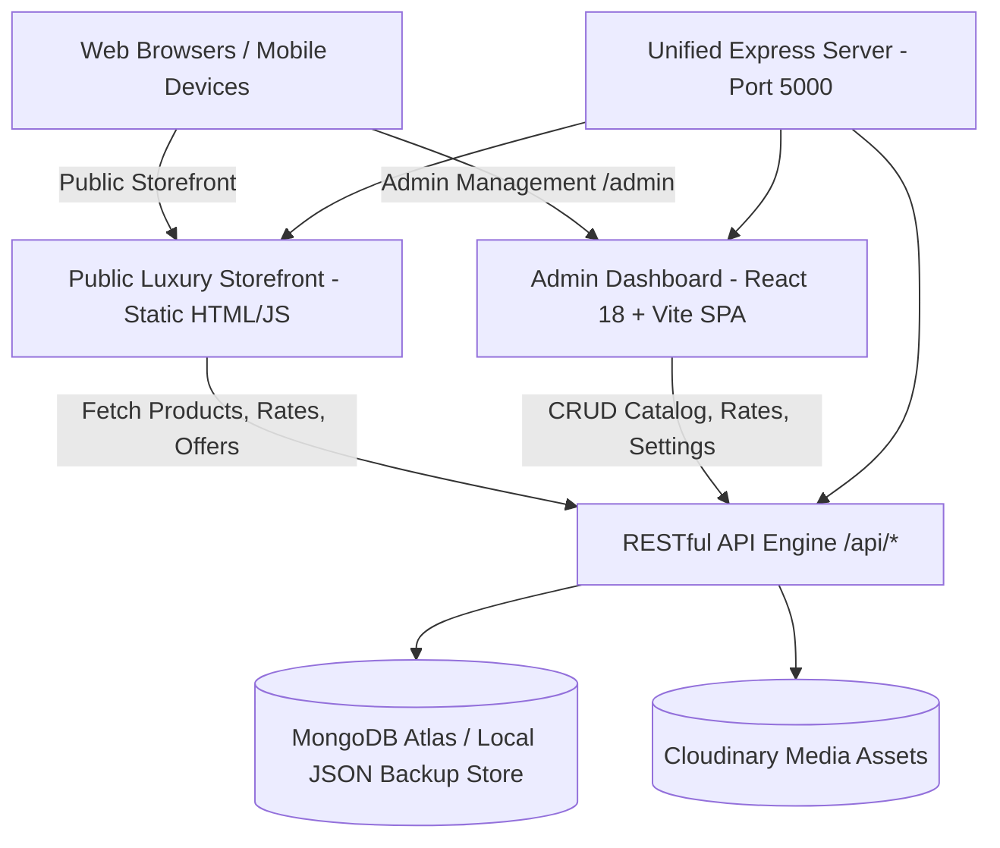

# MGS Jewellerys — Official Digital Commerce & Management Platform

> **Davanagere's Legacy of Pure Gold · Est. 1999**

A full-stack, enterprise-grade luxury jewelry platform for **MGS Jewellerys**, Davanagere, Karnataka. Built as a comprehensive digital transformation system — transitioning a 24-year goldsmith heritage into a high-performance web experience with an integrated React Admin CMS.

---

## 🏛️ System Architecture



---

## 🌐 Public Storefront Pages

| Page | File | Description |
|---|---|---|
| **Homepage** | `index.html` | Hero showcase, interactive collection highlights, festive offers, heritage story, and store locator |
| **Collections** | `collections.html` | Filterable catalog with search, category facets, HUID/BIS purity badges, and inquiry modals |
| **Festival Offers** | `offers.html` | Active promotional campaigns, countdown timers, and Old Gold Exchange valuation |
| **Heritage & Craft** | `heritage.html` | Brand narrative, master artisan craftsmanship, and 24-year legacy |
| **Gold Calculator** | `calculator.html` | Live gold purity valuation, wastage, making charges, and EMI amortization schedule |
| **Admin Portal** | `/admin/` | Integrated React Admin CMS for real-time inventory and pricing management |

---

## 🚀 Quick Start & Development

### 1. Prerequisites
- **Node.js** v18+ and **npm** v9+
- Optional: MongoDB Atlas connection string (or use automated local JSON storage mode)

### 2. Dependency Installation
```bash
# Install root, client, and server dependencies
npm run build
```

### 3. Running the Unified Server
```bash
cd server
node index.js
```
The server will boot on `http://localhost:5000/`, simultaneously serving:
- **Public Luxury Website:** `http://localhost:5000/`
- **Admin Dashboard:** `http://localhost:5000/admin/`
- **REST APIs:** `http://localhost:5000/api/`

### 4. Running Client in Hot-Reload Dev Mode (Optional)
```bash
cd client
npm run dev
```
Accessible at `http://localhost:5173/admin/` with instant Vite HMR.

---

## 🔑 Admin Credentials (Default)
- **Portal URL:** `http://localhost:5000/admin/`
- **Email:** `admin@aurajewellers.com` (or `admin@mgs.com`)
- **Password:** `Password123`

---

## 📡 REST API Reference

| Method | Endpoint | Access | Description |
|---|---|---|---|
| `GET` | `/api/products` | Public | Retrieve active jewelry product catalog |
| `POST` | `/api/products` | Protected | Create new product with images, hallmark, and pricing |
| `PUT` | `/api/products/:id` | Protected | Update existing product details |
| `DELETE` | `/api/products/:id` | Protected | Delete product from catalog |
| `GET` | `/api/rates` | Public | Retrieve current gold (22K, 24K) and silver live market rates |
| `PUT` | `/api/rates` | Protected | Update live market rates across storefront |
| `GET` | `/api/offers` | Public | Retrieve active festival and seasonal promotional campaigns |
| `POST` | `/api/offers` | Protected | Publish new offer with banners and countdown dates |
| `GET` | `/api/settings` | Public | Retrieve site-wide global configurations (hero, contacts) |
| `PUT` | `/api/settings` | Protected | Update branding and contact settings |
| `POST` | `/api/upload` | Protected | Upload media files via Multer / Cloudinary |
| `POST` | `/api/auth/login` | Public | Authenticate administrator and receive JWT token |

---

## ⚙️ Environment Configuration

Create a `.env` file in the root directory:

```env
PORT=5000
JWT_SECRET=your_secure_jwt_secret_token
MONGO_URI=mongodb+srv://<user>:<password>@cluster.mongodb.net/mgs_db
CLOUDINARY_CLOUD_NAME=your_cloud_name
CLOUDINARY_API_KEY=your_api_key
CLOUDINARY_API_SECRET=your_api_secret
GOLD_API_KEY=your_live_rates_provider_key
```

---

## 📞 Store & Business Information

- **Store:** MGS Jewellerys, Vijayalakshmi Road, Near Clock Tower, Davanagere — 577 001
- **Established:** 1999
- **Certifications:** 100% BIS Hallmarked & HUID Certified 22K Gold
- **WhatsApp Direct:** +91 80 2500 0000

---

*© 2026 MGS Jewellerys · Davanagere, Karnataka · All Rights Reserved*

